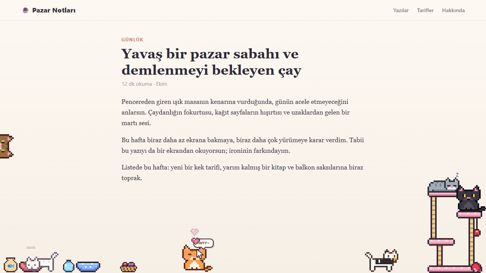
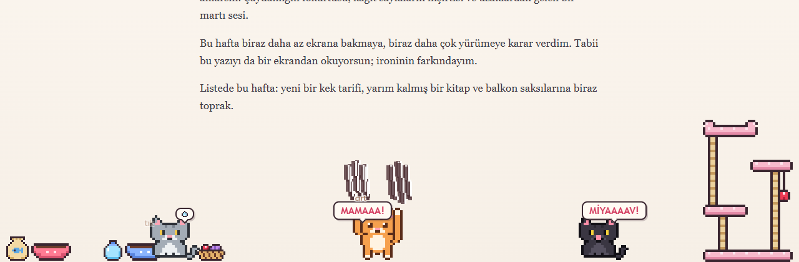
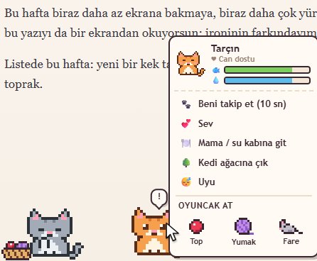
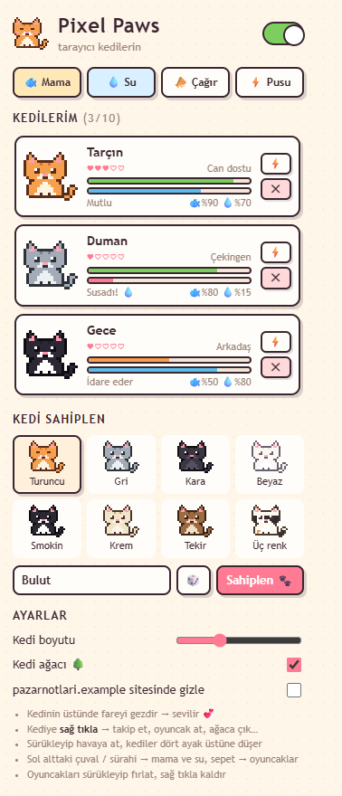

# 🐾 Pixel Paws — Tarayıcı Kedileri

Tarayıcında yaşayan pixel art kediler. Fareni kovalarlar, ekranın kenarından seni dikizlerler, kedi ağacında uyurlar, acıkınca ekranı tırmalarlar. Onları sev, besle, oyuncak at, yenilerini sahiplen.



## Neler yapıyorlar?

**Kendi hallerinde**
- Ekranın altında oturup gözleriyle fareni takip ederler, göz kırpar, kuyruk sallarlar
- Patilerini yalar, somun gibi kıvrılıp uyurlar
- Ekranın kenarından kafalarını uzatıp bakarlar; fareyi yaklaştırırsan utanıp saklanırlar
- Kedi ağacına tırmanırlar, raflarda oturur, en üstteki yatakta uyurlar, direği tırmalarlar

**Seninle**
- Fareyi hızlı oynatırsan peşine düşerler; fare durunca popo sallayıp üstüne atlarlar
- Bazen ekranın sağından koşarak gelip farene **pusu kurar**, "yakaladım!" deyip kaçarlar
- **Takip et** dersen 10 saniye boyunca imlecinin yanında yürürler
- Fırlattığın **top, ip yumağı ve oyuncak fareyi** kovalar, pati atar, havada yakalamaya çalışırlar

**Acıkınca ve susayınca**
- Kap doluysa koşarak gelip yerler ("nom nom") ve içerler ("şap şap")
- Kap boşsa ayağa kalkıp **ekranı tırmalarlar**: camda çizik izleri kalır
- Boş kabın başına oturup sana bakar ve kaba pati atarlar, peşinden gelip miyavlarlar ya da "MİYAAAV!" diye bağırırlar



## Nasıl oynanır?

| Ne yapmak istiyorsun | Nasıl |
|---|---|
| Kediyi sevmek | Fareyi kedinin üstünde gezdir. Gözleri kapanır, kalpler çıkar, mırlar |
| Miyavlatmak | Kediye tıkla |
| Havaya kaldırmak | Kediyi sürükle; bırakınca dört ayak üstüne düşer, bir rafa denk gelirse oraya konar |
| Takip ettirmek, oyuncak atmak, ağaca çıkarmak | Kediye **sağ tıkla** |
| Mama ve su koymak | Sol alttaki çuvala / sürahiye tıkla |
| Oyuncak çıkarmak | Sol alttaki sepete tıkla. Oyuncağı sürükleyip fırlat, sağ tıklayıp kaldır |

<p align="center">
  
</p>

## Kedi sahiplenme ve ayarlar

Uzantı simgesine tıklayınca açılan pencerede:

- **8 renkten** birini seçip en fazla 10 kedi sahiplenebilirsin: turuncu, gri, kara, beyaz, smokin, krem, tekir, üç renk
- Her kedinin adını değiştirebilir, sevgi seviyesini, tokluğunu ve su durumunu görebilirsin
- Tek tıkla mama ve su doldurabilir, kedileri çağırabilir ya da pusu kurdurabilirsin
- Kedilerin boyutunu ayarlayabilir, kedi ağacını kapatabilir, kedileri belirli bir sitede gizleyebilirsin

<p align="center">
  
</p>

## Kurulum

Uzantı henüz Chrome Web Mağazası'nda değil, elle yükleniyor:

1. Bu klasörü bilgisayarına indir
2. Chrome'da `chrome://extensions` sayfasını aç
3. Sağ üstten **Geliştirici modu**'nu aç
4. **Paketlenmemiş öğe yükle**'ye tıkla ve bu klasörü seç
5. Herhangi bir siteyi aç ya da yenile; ilk kedin **Tarçın** koşarak gelecek

Kodda değişiklik yaptıktan sonra `chrome://extensions` sayfasında uzantının **yenile (⟳)** butonuna basıp açık sekmeleri yenilemen yeterli.

## Proje yapısı

```
manifest.json       Uzantı tanımı (Manifest V3)
sprites.js          Tüm pixel art: kediler, kedi ağacı, kaplar, oyuncaklar ve renk paletleri
content.js          Sayfadaki kediler: davranışlar, fizik, sağ tık menüsü, mama ve oyuncaklar
popup.html/.css/.js Uzantı penceresi: kedi listesi, sahiplenme, ayarlar
background.js       İlk kurulumda varsayılan kedi ve ayarlar
icons/              Uzantı ikonları
screenshots/        README görselleri
```

Sprite'lar resim dosyası değil, `sprites.js` içinde karakter ızgaraları olarak tanımlı (`o` kontur, `b` gövde, `w` beyaz, `E` göz…). Her kedi rengi aynı çizimi farklı bir paletle boyar. Gözler fareye bakacak, kırpılacak ya da mutlu olacak şekilde çizim anında hesaplanır.

## Teknik notlar

- **Harici kütüphane yok.** Saf JavaScript; derleme adımı gerektirmez.
- **Sayfayı bozmaz.** Kediler Shadow DOM içinde çizilir, sitenin CSS'inden etkilenmez ve onu etkilemez. Sadece kedilerin, kapların ve oyuncakların üstü tıklanabilir; geri kalan her şey sayfaya geçer.
- **Veri tarayıcıdan çıkmaz.** Kediler, istatistikleri ve ayarlar `chrome.storage.local` içinde tutulur. Uzantı hiçbir sunucuyla konuşmaz.
- **İzinler:** `storage` (kedileri kaydetmek için) ve `activeTab` (pencerede "bu sitede gizle" için açık sitenin adını öğrenmek için).
- Tokluk ve su zamanla azalır; tüm sekmeler aynı kedileri ve aynı mama kabını paylaşır.

## Bilinen sınırlar

- Chrome, uzantıların `chrome://` sayfalarında ve Chrome Web Mağazası'nda çalışmasına izin vermediği için kediler oralarda görünmez.
- Kediler sayfadaki iframe'lerin içinde görünmez, yalnızca ana sayfada yaşarlar.
- Tam ekran videolarda kedi görünmez.
